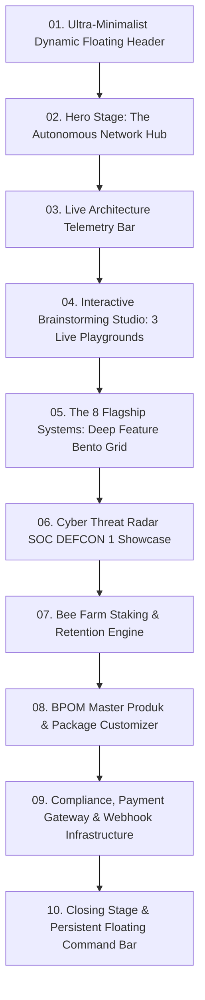

# BIONET ENTERPRISE ECOSYSTEM: LANDING PAGE ARCHITECTURE & INTERACTION DESIGN SPECIFICATION

> **Author**: Lead UX/UI Landing Page Architect & Interaction Designer  
> **Frameworks & Principles**: Hallmark v2.0 (High-density, Anti-Slop, 1-Idea-Per-Screen), Emil Kowalski Design Engineering (Invisible Details, Physical Spring Physics, Compound Polish), Apple Design Foundations (Translucency, Spatial Consistency, Materials & Depth).  
> **Status**: Ready for Frontend Implementation  
> **Target Audience**: Calon Pemilik Bisnis Network Marketing, Top Leader MLM Modern, Distributor Skincare/Herbal, Enterprise Operator.

---

## 1. EXECUTIVE DESIGN PHILOSOPHY & ANTI-SLOP MANIFESTO

Traditional Indonesian MLM & network marketing landing pages from the 2010s suffer from severe design degeneration:
1. Loud, garish gradients (yellow-red-blue), cheesy 3D gold coins, clashing drop-shadows.
2. Fake luxury cars, exaggerated unverified checks/testimonials, and walls of shouting comic-sans/impact text.
3. Completely passive experiences: static screenshots or fake stock illustrations of handshakes.
4. Rigid desktop-first tables that break on mobile screens.

### The Bionet Modern Paradigm (Cyber-Obsidian Luxury & Interaction-First)
- **Zero Fake Slop**: No fake counters, no simulated 5-star badges without proof, no purple-to-blue generic SaaS gradients, no hand-drawn cartoon vectors.
- **Show, Don't Tell**: Instead of saying "Sistem otomatis", the landing page provides **an interactive software sandbox** right in the browser. Visitors can simulate workflows, test the AI auto-responder with real prompts, and calculate exact mathematical compensation models.
- **Apple-grade Depth & Materials**: Deep space cyber-obsidian backdrop (`#04070D`), frosted glassmorphism with crisp sub-pixel borders (`1px solid rgba(255, 255, 255, 0.07)`), subtle specular radial highlights, and fluid spring physics.
- **Emil Kowalski's Tactile Responsiveness**:
  - Buttons depress on click (`transform: scale(0.97)`).
  - Dialogs and tabs morph using Framer Motion shared layout (`layoutId`).
  - Native Web Audio micro-feedback on key interaction states (crisp 1200Hz tick, soft 80Hz bass confirmation).

---

## 2. DESIGN SYSTEM & AESTHETIC FOUNDATION

### 2.1 Color Tokens (`:root`)
All styling is strictly tokenized to adhere to the Hallmark hard floor:

```css
:root {
  /* Backdrops & Obsidian Layers */
  --bg-deep-obsidian: #03060a;
  --bg-surface-elevated: #090f19;
  --bg-surface-card: #0e1726;
  --bg-surface-glass: rgba(14, 23, 38, 0.72);
  --bg-surface-glass-active: rgba(22, 34, 54, 0.85);

  /* Borders & Specular Accents */
  --border-subtle: rgba(255, 255, 255, 0.07);
  --border-focus: rgba(16, 185, 129, 0.45);
  --border-highlight: rgba(255, 255, 255, 0.14);

  /* Primary Brand Accents */
  --neon-emerald-primary: #10b981;
  --neon-emerald-glow: rgba(16, 185, 129, 0.28);
  --neon-emerald-hover: #059669;
  
  /* Telemetry & Secondary Accents */
  --electric-cyan: #06b6d4;
  --electric-cyan-glow: rgba(6, 182, 212, 0.24);
  --honey-amber: #f59e0b;
  --honey-amber-glow: rgba(245, 158, 11, 0.25);
  --threat-crimson: #ef4444;
  --threat-crimson-glow: rgba(239, 68, 68, 0.3);

  /* Typography Scales */
  --text-primary: #f8fafc;
  --text-secondary: #94a3b8;
  --text-muted: #64748b;
  --text-accent: #34d399;

  /* Elevation Shadows & Blurs */
  --glass-blur: blur(20px);
  --glow-emerald-lg: 0 0 50px -10px rgba(16, 185, 129, 0.3);
  --glow-cyan-lg: 0 0 50px -10px rgba(6, 182, 212, 0.25);
}
```

### 2.2 Typography Hierarchy
- **Display Headings**: *Plus Jakarta Sans* / *Cabinet Grotesk* (Weights: 700, 800) – Geometric, authoritative, tight negative letter-spacing (`-0.03em`), never italicized within roman headings.
- **Body & Paragraphs**: *Inter* (Weights: 400, 500, 600) – Unmatched optical legibility, generous line-height (`1.65`), never tracked capitals for paragraph copy.
- **Telemetry, System Codes, Currency & Counters**: *JetBrains Mono* (`font-mono`, tabular figures `font-variant-numeric: tabular-nums`) – Ensures that dynamic number counters do not jitter during spring animations.

### 2.3 Motion & Physics Engineering
- **Spring Parameters**:
  - Modal / Sheet entry: `stiffness: 340, damping: 28, mass: 0.8`
  - Micro-tab switcher: `stiffness: 450, damping: 35`
  - Slider scrubbing: Linear direct response without lagging animation loops
- **Compositor Integrity**: Strictly zero animation on `width`, `height`, `top`, `left`, `margin`. All dynamic spatial transforms are performed exclusively on GPU layers using `transform: translate3d()` and `opacity`.

### 2.4 Web Audio API Synthesizer (Zero-Asset Tactile Sound)
Instead of loading heavyweight MP3s, audio feedback is synthesized in real time via standard Web Audio API oscillator:
```javascript
export const playHapticAudio = (type = 'click') => {
  if (typeof window === 'undefined') return;
  const ctx = new (window.AudioContext || window.webkitAudioContext)();
  const osc = ctx.createOscillator();
  const gain = ctx.createGain();
  osc.connect(gain);
  gain.connect(ctx.destination);

  if (type === 'click') {
    osc.frequency.setValueAtTime(1200, ctx.currentTime);
    osc.frequency.exponentialRampToValueAtTime(400, ctx.currentTime + 0.04);
    gain.gain.setValueAtTime(0.04, ctx.currentTime);
    gain.gain.exponentialRampToValueAtTime(0.001, ctx.currentTime + 0.04);
    osc.start();
    osc.stop(ctx.currentTime + 0.04);
  } else if (type === 'success') {
    osc.frequency.setValueAtTime(520, ctx.currentTime);
    osc.frequency.exponentialRampToValueAtTime(880, ctx.currentTime + 0.08);
    gain.gain.setValueAtTime(0.06, ctx.currentTime);
    gain.gain.exponentialRampToValueAtTime(0.001, ctx.currentTime + 0.08);
    osc.start();
    osc.stop(ctx.currentTime + 0.08);
  }
};
```

---

## 3. SECTION-BY-SECTION LANDING PAGE ANATOMY

The landing page is engineered in 10 seamless vertical stages, structured around a relentless narrative of technological superiority and tangible user experimentation:



---

### SECTION 1: ULTRA-MINIMALIST FLOATING HEADER (Dynamic Island Nav)
- **Visual Form**: Centered pill suspended 20px from screen top with frosted glass (`backdrop-filter: blur(24px); border: 1px solid rgba(255,255,255,0.08)`).
- **Left**: Bionet Minimal Geometric Monogram in Neon Emerald with micro-pulse online status indicator.
- **Center**: Navigation Links (`Fitur Utama`, `Brainstorming Studio`, `Kalkulator Profit`, `SOC Security`, `Pricing`).
- **Right**:
  - Sound FX Toggle (Mute / Unmute subtle interaction haptics).
  - Quick Portal Button (`Masuk ke Dashboard` / `Mulai Bangun Jaringan`).
- **Scroll Behavior**: Condenses in width as the user scrolls past 100px, pinning seamlessly.

---

### SECTION 2: HERO STAGE — "THE AUTONOMOUS NETWORK HUB"
- **Headline (<= 7 words)**: **"Arsitektur Jaringan Modern. Bekerja Otomatis."**
- **Sub-sentence (<= 14 words)**: **"Otomasi binary genealogy, WhatsApp AI closing, dan multi-gateway e-wallet dalam satu ekosistem enterprise."**
- **Primary Interactive Signature Component**:
  - **Live Mini-Genealogy & Transaction Visualizer**:
    - An interactive zoomable canvas where visitors can hover over nodes (Root Node: *Mitra Mahkota*, Left Leg: *Volume 124.500 BV*, Right Leg: *Volume 118.200 BV*).
    - Clicking a "+ Tambah Mitra" simulation node triggers an instant animated balance pairing beam:
      - Neon pulse travels from new downline -> sponsor bonus credited (+Rp 500.000) -> pairing bonus triggers (+Rp 150.000) -> QRIS notification badge flashes.
- **CTA Actions**:
  - Primary: `Coba Brainstorming Studio` (Smooth scroll to Section 4 with spring snap).
  - Secondary: `Eksplorasi Live Demo` (Instant test modal with zero login requirement).

---

### SECTION 3: LIVE ARCHITECTURE TELEMETRY BAR
Replacing the cheesy 2010s "counter numbers" with an authentic, live system telemetry bar:
- **Engine Core Status**: `DEFCON 1 Active · 99.98% Gateway Uptime`
- **Supported Payment Rails**: Dynamic SVG badges for `Bank Indonesia QRIS`, `Midtrans Snap`, `Tripay Open API`, `Xendit Virtual Accounts`.
- **Active WhatsApp AI Instances**: `Waha Multi-Session Isolated Docker`
- **Genealogy Calculation Latency**: `12ms Instant Balance Pairing Engine`

---

### SECTION 4: THE INTERACTIVE BRAINSTORMING STUDIO (CORE SIGNATURE EXPERIENCE)

This is the crown jewel of the landing page. It transforms passive reading into active, high-intent experimentation. It contains 3 interactive tabs:

#### Playground A: Business Modeler & Profit Simulator
- **Interactive Controls**:
  - Slider 1: **Jumlah Direct Sponsor per Bulan** (Range: 2 - 50 mitra)
  - Slider 2: **Pilihan Paket Join Tim** (Paket Silver @ Rp 1.5jt | Gold @ Rp 4.5jt | Platinum @ Rp 12.5jt)
  - Slider 3: **Rata-rata Repeat Order (RO) Produk Bulanan** (Range: 1 - 10 box/bulan)
- **Instant Reactive Dashboard**:
  - **Bonus Sponsor Langsung**: Rp X.XXX.000
  - **Bonus Pairing Binary (Kiri:Kanan)**: Rp Y.YYY.000
  - **Royalti Repeat Order (Unilevel Pass-up)**: Rp Z.ZZZ.000
  - **Estimasi Passive Income Bulanan**: Highlighted in electric emerald with dynamic odometer counter.
- **Presets Quick Select**:
  - `[Pemula / Part-Time]` (2 Sponsor, 2 RO)
  - `[Leader Aktif]` (10 Sponsor, 5 RO)
  - `[Master Stockist / Top Earner]` (30 Sponsor, 10 RO, Tim Spillover)

#### Playground B: Live AI Smart Closing Playground
- **Concept**: Calon pemilik bisnis atau calon mitra sering ragu: *"Apakah bot WhatsApp-nya beneran pintar meladeni customer?"*
- **Interactive UI**:
  - Left Panel: **Selector Persona Keberatan Prospek**:
    - Chip 1: `"Harganya mahal banget ya mas..."`
    - Chip 2: `"Saya gaptek, ga punya pengalaman jualan..."`
    - Chip 3: `"Ini bisnis MLM tipu-tipu skema ponzi kan?"`
    - Chip 4: `"Saya ga punya waktu buat prospek orang..."`
    - Free Input: Custom text box where the visitor can type any realistic customer objection.
  - Middle: **Target Niche Switcher**:
    - `[Kesehatan Herbal]` | `[Skincare & Beauty]` | `[Digital Tools & Membership]`
  - Right Panel: **Live WhatsApp Chat Simulator Window**:
    - Visitors click `"Generate AI Closing Script"`.
    - The chat window plays real typing indicators (`Typing...`) and streams the response instantly using the 3-Step Psychological Closing Formula:
      1. *Empathy & Validation* ("Paham sekali Bu, banyak mitra kami awalnya juga merasa demikian...")
      2. *Value Reframe & BPOM Evidence* ("Faktanya, produk ini bersertifikasi BPOM resmi dan memberikan margin 40%...")
      3. *Stacked Button Action Trigger* (Simulated WhatsApp interactive buttons: `[Lihat Uji Klinis]`, `[Ambil Promo Hari Ini]`, `[Konsultasi Tim Ahli]`).

#### Playground C: Interactive Workflow Simulator (Full Loop Visualizer)
- **Concept**: Clickable interactive pipeline showing how a cold stranger becomes money in the e-wallet in under 60 seconds without manual admin work.
- **Interactive Nodes**:
  1. `[BioLink / TikTok Ads]` -> Visitor clicks "Simulasikan Klik Iklan"
  2. `[WhatsApp AI Auto-Responder]` -> Stacked interactive button auto-reply flashes on screen
  3. `[QRIS Instant Checkout]` -> Dynamic QR Code generates with countdown timer
  4. `[Automated Webhook & Callback]` -> Payment confirmed via Midtrans/Tripay (HTTP 200 OK)
  5. `[Genealogy Pairing & E-Wallet Split]` -> Bonus sponsor split to upline, pairing balance credited, honey nectar added to Bee Farm
  6. `[Automated Warehouse Dispatch]` -> Order dispatched to warehouse shipping queue
- **Live Data Inspector**: Clicking any step shows the raw JSON payload and backend state mutation in a glassmorphic inspector tab.

---

### SECTION 5: THE 8 FLAGSHIP SYSTEMS (DEEP FEATURE BENTO GRID)
A high-craft bento grid displaying the full scope of Bionet’s technological stack:

1. **Jaringan MLM & Binary Genealogy Tree**
   - Infinite zoom/pan canvas, automated spillover routing, left/right leg balance optimizer, downline activity heatmaps.
2. **Automated E-Wallet & Multi-Payment Gateway**
   - Tripay, Midtrans, Xendit, Bank Indonesia QRIS, automated split billing, instant bank transfer withdrawal batching.
3. **CRM Prospek Kanban Pipeline & Lead Capture**
   - Drag-and-drop lead cards from *New Lead* -> *Follow Up 1* -> *Hot Presentation* -> *Closing Paid*. Integrated with TikTok & Meta Lead Ads webhooks.
4. **WhatsApp AI Messenger Suite**
   - Multi-device Waha integration, interactive stacked action buttons, auto-greeting based on lead referral tag, delivery telemetry (Sent, Delivered, Read receipts).
5. **Webmail & AI Auto-Responder Suite**
   - Built-in IMAP/SMTP webmail client, AI email copy generator, automated follow-up sequences, SPF/DKIM verified delivery.
6. **Cyber Threat Radar SOC DEFCON 1 Command Center**
   - Real-time GeoIP attack vector monitoring, honeypot telemetry, automated brute-force IP throttling, multi-layer fraud shield.
7. **Gamifikasi Bee Farm (Honey Harvest Staking)**
   - Honeycomb yield staking mechanism, daily nectar harvest, downline inactivity wake-up rewards, digital honey-to-cash conversion.
8. **BPOM Master Produk & Custom Join Packages**
   - Real-time BPOM registration lookup, interactive package tier builder, dynamic BV (Business Value) & profit margin calculation.

---

### SECTION 6: CYBER THREAT RADAR SOC DEFCON 1 SHOWCASE
- **Visual Vibe**: Dark military-grade cybersecurity command center.
- **Component**:
  - Live animated GeoIP vector map simulating blocked malicious requests from overseas botnets.
  - Honeypot attack telemetry log with live timestamps and mitigation rules (`Rate Limiting Activated: 429 Too Many Requests`).
  - DEFCON 1 Status Badge confirming strict database encryption, OWASP top 10 compliance, and transactional atomicity.

---

### SECTION 7: GAMIFIKASI BEE FARM & RETENTION ARCHITECTURE
- **Problem Solved**: MLM traditionally suffers from a 70%+ downline drop-off rate after 30 days.
- **The Bionet Solution**:
  - Honeycomb interactive staking visualizer: Every repeat order and downline activity produces **Nectar**.
  - Members claim daily honey harvest, which can be exchanged for real cash bonuses, product discounts, or luxury tour reward tickets.
  - Downline Inactivity Warning cards that trigger automated WhatsApp nudges before a downline goes dormant.

---

### SECTION 8: BPOM MASTER PRODUK & PACKAGE CONFIGURATOR
- **Interactive UI**:
  - Switcher between available official products (e.g. *Bio Herbal Madu Propolis*, *Bio Gluta Collagen Glow*, etc.).
  - Shows verified BPOM RI registration numbers with direct link verification indicator.
  - Interactive Package Tier Configurator: Combine quantities, calculate instant margin, cash back, and pairing point potential.

---

### SECTION 9: ENTERPRISE INFRASTRUCTURE & DEVELOPER COMPLIANCE
- **Technical Specs Grid**:
  - Architecture: React 18, Tailwind CSS, Framer Motion, Node.js REST API with SQLite/PostgreSQL redundancy.
  - High Concurrency: Tested for 100,000+ concurrent tree traversals with zero deadlocks.
  - Security Standards: ISO 27001 readiness, Bank Indonesia QRIS sandbox compliant, End-to-end encrypted sessions.

---

### SECTION 10: CLOSING STAGE & PERSISTENT FLOATING COMMAND BAR
- **Final Conversion Stage**:
  - Headline: **"Mulai Transformasi Jaringan Bisnis Anda Hari Ini."**
  - Instant Contact via WhatsApp VIP Support or Register for Live 1-on-1 Onboarding.
- **Persistent Floating Command Bar (Bottom Screen on Mobile & Desktop)**:
  - Appears after scrolling 40% of the landing page.
  - Frosted glass capsule housing:
    - Left: Active System Telemetry (`● DEFCON 1 OK | WA Bot Ready`).
    - Center: `Hitung Potensi Profit` (Triggers floating Quick Calculator Modal).
    - Right: `Konsultasi VIP WhatsApp` (Direct deep-link with pre-filled lead tracking tag).

---

## 4. DETAILED COMPONENT WIREFRAME SPECIFICATIONS

### 4.1 Brainstorming Studio Tab Component Anatomy
```
+---------------------------------------------------------------------------------------+
|  [Tabs: 1. Business Modeler (ROI) | 2. AI Smart Closing WA | 3. Workflow Simulator]    |
+---------------------------------------------------------------------------------------+
|                                                                                       |
|  [SLIDERS PANEL]                                  [REALTIME PROFIT PROJECTION]        |
|                                                                                       |
|  Direct Sponsor: [====O=============] 8 Mitra      Total Payout:    Rp 18.450.000     |
|  Paket Join:    [ Silver | *Gold* | Platinum ]     Sponsor Bonus:   Rp  8.000.000     |
|  Repeat Order:  [=========O=========] 5 Box/bln    Pairing Bonus:   Rp  6.250.000     |
|                                                    Bee Farm Yield:  Rp  4.200.000     |
|  Presets:                                                                             |
|  [Pemula] [Leader Aktif] [*Top Earner*]            [ CTA: Ambil Paket Ini Sekarang ]  |
+---------------------------------------------------------------------------------------+
```

### 4.2 Live WhatsApp AI Objection Handler Anatomy
```
+---------------------------------------------------------------------------------------+
|  PILIH KEBERATAN KONSUMEN:                          SIMULATOR WHATSAPP LIVE:          |
|  ( ) "Harga kemahalan mas"                          +-------------------------------+ |
|  (*) "Ini MLM penipuan ya?"                         | [WA Header: Bionet AI Bot]    | |
|  ( ) "Saya gaptek ga bisa jualan"                   |                               | |
|  ( ) Custom: [ Ketik disini...          ]           | User: "Ini MLM penipuan ya?"  | |
|                                                     |                               | |
|  Niche: [*Herbal* | Skincare | Bisnis]              | Bot: [Typing...]              | |
|                                                     | "Halo Kak! Kami paham rasa    | |
|  [ Tombol: Generate AI Closing Script ]             | khawatir Kakak. Bionet bukan  | |
|                                                     | money game, melainkan sistem  | |
|                                                     | resmi berizin BPOM dengan..." | |
|                                                     | [Stacked Button: Cek BPOM]    | |
|                                                     | [Stacked Button: Cara Kerja]  | |
+---------------------------------------------------------------------------------------+
```

---

## 5. ACCESSIBILITY, REDUCED-MOTION & PERFORMANCE CHECKLIST

1. **Accessibility (WCAG AA Compliance)**:
   - All interactive controls have `:focus-visible` outline in `--neon-emerald-primary`.
   - Contrast ratio of all text against obsidian background is >= 7:1 (exceeds AAA standards).
   - Form inputs and sliders have explicit `aria-label` and `aria-valuenow` attributes.
2. **Reduced-Motion Fallback (`prefers-reduced-motion: reduce`)**:
   - Disables all infinite radial glow pulses and floating particle loops.
   - Spring transforms fall back to instant state toggles (`transition: none; transform: none`).
3. **Performance & Frame Budget**:
   - 60 FPS guaranteed on mobile devices.
   - Zero layout thrashing (`getComputedStyle` or DOM measurements avoided during render loops).
   - Dynamic imports for heavyweight chart components.

---
*Ready for React 18 component scaffolding in `frontend/src/pages/LandingPage.jsx`.*
