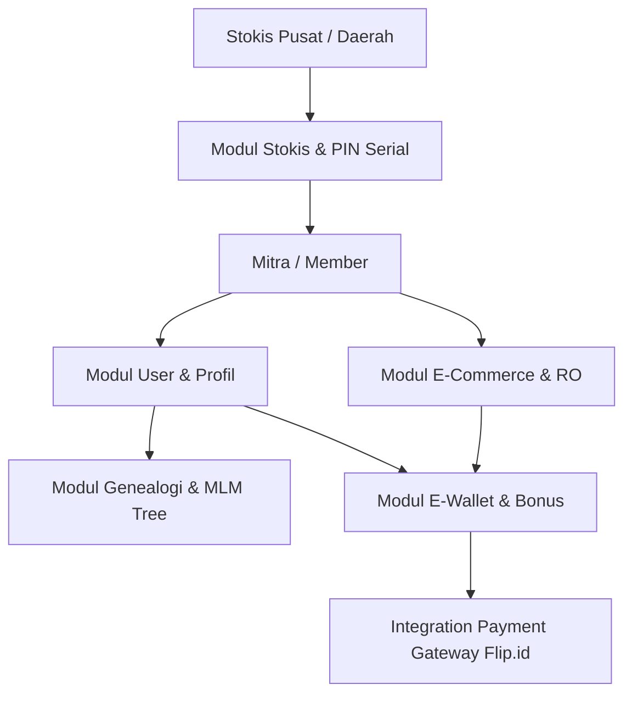

# Project Documentation - Rebuild Bionet

Selamat datang di dokumentasi resmi proyek **Rebuild Bionet**. Dokumentasi ini berisi hasil analisa mendalam dari database `bionetv5` serta rekomendasi arsitektur database dan sistem baru untuk proses pengembangan ulang (*rebuild*).

---

## 📑 Daftar Isi Dokumentasi

1. [**Analisa & Spesifikasi Skema Database (`database_schema.md`)**](./database_schema.md)
   - Deskripsi lengkap 70 tabel bawaan dari database `bionetv5`.
   - Pengelompokan 8 modul utama sistem (User, Genealogi MLM, Wallet, PIN/Stokis, Bonus & Reward, E-Commerce, Master Wilayah, System/Log).
   - Kamus data, jumlah baris, dan indeks utama tiap modul.

2. [**Rencana Arsitektur & Migrasi Rebuild (`rebuild_plan.md`)**](./rebuild_plan.md)
   - Daftar 26 tabel yang direkomendasikan untuk didepresiasi/dihapus (tabel kosong & duplikat).
   - Strategi penyederhanaan skema dari 70 tabel menjadi 35 tabel inti.
   - Strategi optimasi *Tree Closure Table* untuk hirarki Sponsor & Upline.
   - Rekomendasi normalisasi Primary Key / Foreign Key (`user_id` vs `username`).

3. [**Laporan Status Progress & Pending Roadmap (`STATUS_PROGRESS_REBUILD.md`)**](./STATUS_PROGRESS_REBUILD.md)
   - Matriks komparasi fitur yang sudah selesai dikerjakan vs belum dikerjakan.
   - Analisis kesenjangan pada Fase 1-4 dan PRD Dashboard Mitra.
   - Catatan audit UI/UX dan rencana sprint selanjutnya.

---

## 🏗️ Gambaran Arsitektur Sistem Bionet

Sistem Bionet merupakan platform **Network Marketing (MLM)** berbasis E-Commerce yang mengintegrasikan:
- **Sistem Pasangan & Sponsor (Binary Tree MLM)**
- **Sistem PIN Serial & Stokis Daerah**
- **Ledger Keuangan Digital (E-Wallet & Automatic Withdrawal via Flip.id)**
- **E-Commerce Produk Kesehatan & Repeat Order (RO)**

---

## 📊 Summary Statistik Database Source (`bionetv5`)

- **Database Engine**: MySQL 8.3 (Localhost)
- **Total Tabel**: 70 Tabel (44 Tabel Berisi Data, 26 Tabel Kosong)
- **Total Baris Data**: 751,591 Baris
- **Ukuran Basis Data**: ~83.69 MB
- **Teknologi Framework Asal**: Node.js dengan ORM Sequelize

---
*Dokumentasi ini dibuat otomatis oleh AI Assistant untuk tim pengembang Rebuild Bionet.*
