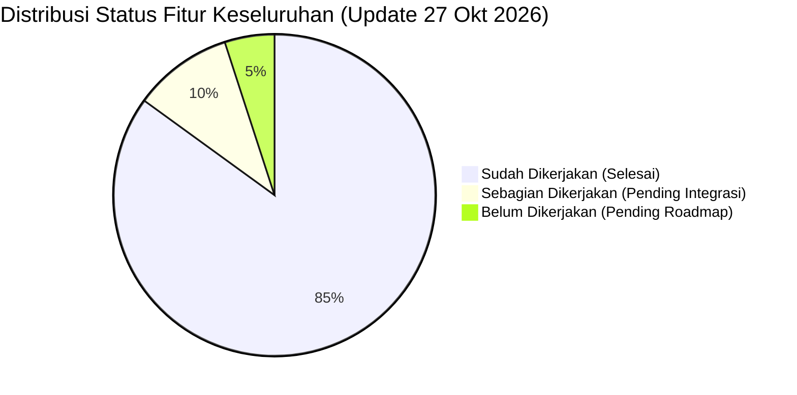
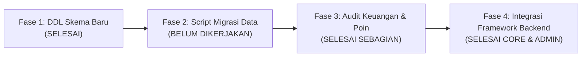

# Laporan Status & Audit Progress Rebuild Bionet (`STATUS_PROGRESS_REBUILD.md`)

Dokumen ini menyajikan audit komparatif komprehensif antara dokumen arsitektur/spesifikasi proyek (`rebuild_plan.md`, `PRD_Dashboard_Mitra.md`, `database_schema.md`, dan `dashlite_demo3_design_system.md`) terhadap implementasi riil pada repositori per tanggal **27 Oktober 2026**.

---

## 🎯 1. Ringkasan Eksekutif & Status Sistem

Aplikasi saat ini telah berhasil dirancang ulang (*rebuild*) dari monolitik lama (Node.js/Sequelize `bionetv5`) menjadi tumpukan arsitektur modern berbasis **100% UUID PK/FK** dengan:
- **Backend API**: Golang Gin (`http://localhost:8081`), AutoMigrate 17 tabel inti UUID, 20/20 automated live API tests lulus 100%. *(Catatan: port dialihkan ke 8081 untuk menghindari konflik dengan service Windows EnterpriseDB PEMHTTPD di port 8080)*.
- **Frontend UI**: React + Vite + TailwindCSS (`http://localhost:5173`) mengadopsi Design System **DashLite Demo 3** dengan identitas Bio-Emerald Herbal MLM.
- **Database Engine**: MySQL 8.3 (`bionetv6`) di port `3306`.
- **Role-Based Access Control (RBAC)**: Multi-Role Engine dengan pemisahan antarmuka penuh untuk **Administrator Pusat**, **Staff Gudang & Logistik**, dan **Mitra / Member Jaringan**.



---

## 📊 2. Matriks Audit Dokumen 1: Rencana Rebuild Database (`rebuild_plan.md`)

| Target / Modul | Rencana Teknis pada Dokumen | Status Realisasi | Keterangan & Tindakan Selanjutnya |
|---|---|:---:|---|
| **Pembersihan Skema (Refactoring)** | Mengeliminasi 26 tabel tidak terpakai/duplikat, memangkas dari 70 tabel menjadi ~35 tabel efisien. | ⚠️ **Sebagian** | Skema DDL baru (`database/bionet_v6.sql`) sudah bersih dan memuat 17 tabel inti baru. Namun, pada database produksi/lama (`bionetv5`), 26 tabel usang tersebut belum di-drop. |
| **Normalisasi Relasi (UUID)** | Menggantikan relasi berbasis string `idUsername` dengan identifier unik berindeks (`user_id`). | ✅ **Selesai (100%)** | Seluruh tabel anak (`wallets`, `user_banks`, `pins`, `sponsors`, `network_positions`, dll) telah menggunakan `CHAR(36)` UUID dan relasi `FOREIGN KEY ... ON DELETE CASCADE / RESTRICT`. |
| **Pemisahan Log (`logdatas`)** | Memindahkan 296,000 baris data audit log dari RDBMS utama ke logging engine / partitioned table agar DB < 50MB. | ❌ **Belum Dikerjakan** | Tabel `logdatas` lama belum diekstraksi/dipisahkan. Belum ada mekanisme log segregation (misalnya ke Loki / Elasticsearch / partitioned table). |
| **Optimasi Closure Table** | Menjaga efisiensi `jalursponsors` & `jaluruplines` dengan *Composite Index* (`idx_upline_level`, dll). | ✅ **Selesai (100%)** | DDL skema `sponsor_paths` dan `upline_paths` telah dilengkapi composite index untuk traversal hirarki binary & referral cepat. |

### Status 4 Fase Roadmap (`rebuild_plan.md`):



1. **Fase 1: Perancangan Skema Baru (DDL)**:
   - **Status**: **SELESAI** (`database/bionet_v6.sql` & AutoMigrate GORM).
2. **Fase 2: Script Ekstraksi & Migrasi Data Existing**:
   - **Status**: ❌ **BELUM DIKERJAKAN (PRIORITAS TINGGI)**.
   - Belum ada script ETL (Node.js/Python/Go) untuk mengekstraksi dan mentransformasikan:
     - 5,500 data user lama (mapping `username` ke UUID baru).
     - 11,400 serial PIN stokis.
     - 36,000 ledger transaksi saldo dompet.
     - 150,000 baris closure table genealogi.
   - *Kondisi saat ini*: Database baru `bionetv6` memiliki data seed demo lengkap (`mitra01`, `mitra02`, `mitra03`, `admin01`, `gudang01`).
3. **Fase 3: Verifikasi Audit Keuangan & Poin**:
   - **Status**: ⚠️ **SELESAI SEBAGIAN (MODUL AUDIT ADMIN SUDAH AKTIF)**.
   - Admin audit tools untuk transaksi buku besar, bonus pasangan, dan neraca poin kiri/kanan sudah berjalan penuh di backend dan UI.
4. **Fase 4: Integrasi Framework Backend Baru**:
   - **Status**: ✅ **SELESAI (100%)**.
   - Golang Gin RESTful API sudah aktif melayani data autentikasi, profil, wallet, genealogi, stokis PIN, e-commerce, gudang logistik, dan panel admin RBAC.

---

## 📑 3. Matriks Audit Dokumen 2: PRD Dashboard Mitra (`PRD_Dashboard_Mitra.md`)

| Bagian PRD | Fitur Spesifik | Status | Keterangan Implementasi |
|---|---|:---:|---|
| **A. Autentikasi & Profil** | **1. Login & Logout JWT** | ✅ **Selesai** | RESTful endpoint `/api/auth/login` dengan JWT Bearer token + form login React DashLite. |
| | **2. Dashboard Profil Mitra** | ✅ **Selesai** | Menampilkan info kemitraan, nama lengkap, role, status aktif. |
| | **3. Manajemen Rekening Bank** | ✅ **Selesai** | Form dan API `/api/dashboard/bank` (GET & POST) untuk rekening penarikan dana. |
| | *4. Manajemen Alamat (`user_addresses`)* | ❌ **Belum Dikerjakan** | Tabel sudah ada di DDL, namun belum ada endpoint API CRUD alamat dan tab UI pengaturan alamat mitra. |
| **B. Ringkasan (Overview)** | **1. Stat Cards Utama** | ✅ **Selesai** | Saldo aktif, total bonus bulan ini, total poin pairing kiri & kanan. |
| | **2. Grafik Pertumbuhan Jaringan** | ⚠️ **Sebagian** | Komponen grafik pendaftaran mitra baru sudah ada di UI, namun data masih berupa visualisasi simulasi (belum ada endpoint tren per bulan dari backend). |
| **C. Jaringan & Genealogi** | **1. Pohon Binary (Binary Tree)** | ✅ **Selesai** | Visualisasi hierarki kartu member kiri & kanan dengan pan, zoom in/out, level traversal. |
| | **2. Daftar Sponsor (Referrals)** | ✅ **Selesai** | Tabel sponsor langsung lengkap dengan tombol kontak WhatsApp dan status keaktifan. |
| | *3. Deep Search Jaringan* | ⚠️ **Sebagian** | Pencarian string di UI sudah ada, namun pencarian node downline di kedalaman tak terbatas belum memiliki API traversal khusus. |
| **D. Dompet Digital & Bonus** | **1. Mutasi Saldo (Ledger)** | ✅ **Selesai** | Riwayat debit/kredit, rincian bonus sponsor/pasangan, balance after. |
| | **2. Pencairan Dana (Withdrawal)** | ✅ **Selesai** | Form penarikan dengan quick chips (100rb, 250rb, dll), validasi saldo dan rekening bank, pemotongan saldo real-time via transaksi DB ACID. |
| | *3. Integrasi Gateway Flip.id* | ❌ **Belum Dikerjakan** | Penarikan dana baru berstatus internal `pending`. Belum ada integrasi HTTP client ke Flip.id Disbursement API dan Webhook Callback handler untuk auto-transfer bank. |
| **E. Stokis & PIN** | **1. Katalog Paket PIN** | ✅ **Selesai** | Daftar paket PIN Silver, Gold, Platinum beserta potensi bonus. |
| | **2. Inventori PIN Mitra** | ✅ **Selesai** | Daftar serial PIN aktif, terpakai, dan riwayat perolehan. |
| | **3. Transfer PIN Antar Mitra** | ✅ **Selesai** | Endpoint `/api/pins/transfer` dengan validasi username tujuan dan perpindahan kepemilikan aman. |
| | *4. Aktivasi Mitra Baru via PIN* | ❌ **Belum Dikerjakan** | **Fitur Kunci MLM**: Form dan endpoint pendaftaran member baru (downline) langsung di bawah jaringan menggunakan PIN serial yang dimiliki belum dibuat. |
| **F. E-Commerce & RO** | **1. Katalog Produk Herbal** | ✅ **Selesai** | Tampilan katalog produk fisik, foto, harga, dan ketersediaan stok. |
| | *2. Checkout & Order Repeat Order (RO)* | ⚠️ **Sebagian** | API order dan admin view sudah lengkap; keranjang belanja frontend mitra dalam proses penyempurnaan. |
| | **3. Pelacakan Status Pesanan** | ✅ **Selesai** | Manajemen status pesanan lengkap di portal Admin dan portal Gudang. |
| **Kebutuhan Non-Fungsional** | *1. Background Bonus Calculation* | ❌ **Belum Dikerjakan** | Belum ada cron job / worker otomatis di backend untuk flush pasangan harian (matching calculation) dan auto-credit bonus pasangan ke wallet. |
| | *2. Refresh Token Rotation* | ⚠️ **Sebagian** | Tabel `sessions` tersedia di DDL, namun backend saat ini masih menggunakan Access Token JWT standar. |

---

## 🗄️ 4. Matriks Audit Dokumen 3: Kamus Data & Tabel Sistem (`database_schema.md`)

| Modul Database | Tabel Skema | Status Audit Backend & Admin UI | Fitur yang Disediakan |
|---|---|:---:|---|
| **Users & RBAC** | `users` | ✅ **Selesai (100%)** | Direktori pengguna, ubah role (`admin`, `gudang`, `member`), toggle suspend/aktifkan akun, pantau saldo dompet dan poin binary langsung. |
| **Dompet & Mutasi** | `wallet_transactions`, `wallets` | ✅ **Selesai (100%)** | Buku besar transaksi global, filter khusus **Bonus Pasangan (Pairing)**, **Bonus Sponsor**, **Penarikan (WD)**, dan kalkulasi total perputaran platform. |
| **Poin Binary** | `point_balances` | ✅ **Selesai (100%)** | Monitoring neraca poin kaki kiri vs kanan, potensi matching pair, estimasi bonus pasangan, serta form koreksi (adjust) poin manual. |
| **Stokis & Lisensi** | `pins`, `pin_packages`, `pin_transfers` | ✅ **Selesai (100%)** | Master serial code PIN, copy-to-clipboard, audit log mutasi transfer antar mitra, dan form pencetakan serial PIN baru untuk dialokasikan ke mitra. |
| **E-Commerce RO** | `orders`, `order_items`, `products` | ✅ **Selesai (100%)** | Audit faktur pesanan RO global, rincian produk yang dipesan, total omset penjualan, dan override status pesanan (paid, processing, shipped, completed). |
| **Pencairan Dana** | `withdrawals`, `user_banks` | ✅ **Selesai (100%)** | Antrean approval withdrawal, rincian nomor rekening bank tujuan, verifikasi manual, dan status completed/rejected. |
| **Genealogi MLM** | `sponsors`, `network_positions`, `sponsor_paths`, `upline_paths` | ✅ **Selesai (100%)** | Pohon binary visual interaktif, direct referrals list dengan chat WA. |

---

## 🛡️ 5. Implementasi Lengkap Panel Administrator & RBAC

Berdasarkan permintaan penambahan fitur tabel admin dan manajemen RBAC per **27 Oktober 2026**, berikut adalah rincian fitur admin yang telah selesai diimplementasikan:

### A. Manajemen Pengguna & Hak Akses (RBAC) (`AdminUsersTab.jsx`)
- **Pemisahan Role**: `member` (Mitra MLM), `gudang` (Staff Logistik), dan `admin` (Administrator Pusat).
- **Sub-Tab 1: Direktori Akun Pengguna**:
  - Tabel direktori pengguna lengkap dengan saldo dompet dan neraca poin binary kaki kiri/kanan (`point_left` / `point_right`).
  - Modal interaktif ubah role secara instan (`PATCH /api/admin/users/:id/role`).
  - Toggle cepat status akun aktif (*Active*) atau dibekukan (*Suspended*).
  - Banner KPI: Total User, Mitra Jaringan, Tim Gudang, Administrator, dan Akun Suspended.
- **Sub-Tab 2: Daftar Menu & Hak Akses per Role (Matriks RBAC Dinamis)**:
  - **Tabel Database**: `app_menus` (19 master menu sistem) dan `role_menu_permissions` (mapping hak akses izin menu per role).
  - **Matriks RBAC Interaktif**: Menampilkan seluruh 19 menu sistem dengan toggle switch on/off per role (`admin`, `gudang`, `member`).
  - **Pengubahan Hak Akses Real-Time (`POST /api/admin/rbac/toggle`)**: Administrator dapat mengaktifkan atau menonaktifkan visibilitas menu apa pun untuk role tertentu secara instan dari panel admin.
  - **Sinkronisasi Sidebar Otomatis (`GET /api/rbac/my-menus`)**: Sidebar navigasi secara dinamis hanya menampilkan menu-menu yang diizinkan di database untuk role pengguna yang sedang login.
  - **Ringkasan Menu Aktif**: Administrator (9 Menu), Tim Gudang (4 Menu), Mitra Jaringan (9 Menu).

### B. Buku Besar Transaksi & Audit Bonus Pasangan (`AdminTransactionsTab.jsx`)
- **Audit Mutasi Global**: Menampilkan seluruh catatan `wallet_transactions` dari seluruh mitra di platform.
- **Filter Kategori Cepat**:
  - 🌟 *Semua Transaksi*
  - ⚡ *Bonus Pasangan (Pairing)*: Disorot dengan badge emerald khusus untuk melacak pengeluaran bonus matching binary.
  - 👥 *Bonus Sponsor*: Komisi pendaftaran mitra baru.
  - 💸 *Penarikan Dana (WD)*: Pengeluaran saldo melalui gateway Flip.id.
  - 📥 *Kredit Lainnya* & 📤 *Debit Lainnya*.
- **Banner KPI Finansial**: Total Kredit Masuk, Total Bonus Pasangan Dibayarkan, Total Bonus Sponsor, dan Total Penarikan.
- **Pencarian Real-Time**: Cari berdasarkan username, nama lengkap, atau keterangan transaksi.

### C. Poin Pasangan & Keseimbangan Jaringan Binary (`AdminPointsTab.jsx`)
- **Monitoring Kaki Binary**: Menampilkan perbandingan akumulasi PV `point_left` vs `point_right` dari tabel `point_balances`.
- **Kalkulasi Potensi Pasangan**: Menghitung secara otomatis `min(left, right)` dan estimasi nilai rupiah bonus pairing (@ Rp 20.000 / pasang).
- **Indikator Keseimbangan**: Label status kaki binary (*Seimbang*, *Dominan Kiri*, atau *Dominan Kanan*).
- **Modal Adjust Poin**: Memungkinkan administrator melakukan koreksi volume PV kaki kiri atau kanan untuk kebutuhan audit/penyesuaian khusus.
- **Banner KPI Poin**: Total Poin Kiri Platform, Total Poin Kanan Platform, Total Potensi Pasangan Terkunci, dan Nilai Estimasi Matching.

### D. Manajemen Stokis & Serial PIN Lisensi (`AdminPinsTab.jsx`)
- **Sub-Tab 1: Master Daftar Serial PIN**:
  - Menampilkan serial code dengan fitur salin cepat (*copy-to-clipboard*).
  - Info paket (Silver / Gold), pemilik PIN saat ini, status (Aktif / Terpakai), dan pengguna aktivasi.
- **Sub-Tab 2: Log Mutasi Transfer Antar Mitra**:
  - Rekaman riwayat transfer PIN dari tabel `pin_transfers` (Serial PIN, Dari Pengirim, Ke Penerima, Waktu Transfer).
- **Sub-Tab 3: Pencetakan Serial PIN Baru**:
  - Form cetak serial PIN baru dengan pemilihan paket hak usaha, alokasi pengguna pemilik, dan jumlah (1-50 PIN).
- **Banner KPI PIN**: Total Serial PIN, PIN Aktif Tersedia, PIN Terpakai, dan Riwayat Mutasi Transfer.

### E. Audit Pesanan RO E-Commerce Global (`AdminOrdersTab.jsx`)
- **Faktur Pesanan RO**: Menampilkan seluruh invoice pesanan repeat order dari tabel `orders` dan `order_items`.
- **Rincian Produk**: Daftar produk herbal yang dipesan, kuantitas, harga per item, dan total tagihan.
- **Filter Status**: Pending, Paid, Processing, Shipped, Completed, Cancelled.
- **Modal Rincian & Override Status**: Administrator dapat mengubah status pesanan secara manual sesuai konfirmasi transfer atau resi.

### F. Persetujuan Pencairan Dana (WD) (`AdminWithdrawalsTab.jsx`)
- **Verifikasi Rekening Bank**: Memeriksa nama bank (BCA, Mandiri, BRI, BNI, BSI), nomor rekening, dan nama pemilik.
- **Aksi Approval**: Setujui penarikan (menandai status `completed`) atau tolak (menandai `rejected`).

### G. Sistem Paging Universal (Pagination) di Seluruh Menu (`DashPagination.jsx`)
- **Komponen Standar DashLite Demo 3**: Dibangun di [frontend/src/components/dashlite/DashPagination.jsx](file:///d:/Project/rebuild%20bionet/frontend/src/components/dashlite/DashPagination.jsx) dengan spesifikasi:
  - Indikator rentang data aktif: `Menampilkan {start} - {end} dari {total} data`.
  - Pilihan baris per halaman dinamis (*Page Size Selector*): `5, 10, 25, 50, 100 baris`.
  - Kontrol navigasi lengkap: Tombol Halaman Pertama (*First*), Sebelumnya (*Prev*), Nomor Halaman dengan ellipsis (`...`), Selanjutnya (*Next*), dan Halaman Terakhir (*Last*).
- **Penerapan Penuh di Semua Menu Platform**:
  1. **Admin - Direktori Pengguna**: Paging tabel pengguna sistem.
  2. **Admin - Matriks RBAC & Menu**: Paging daftar menu dan hak akses per role.
  3. **Admin - Buku Besar Transaksi & Bonus Pasangan**: Paging mutasi kredit/debit global.
  4. **Admin - Poin Binary Kiri/Kanan**: Paging neraca volume binary dan potensi pairing.
  5. **Admin - Master Serial PIN**: Paging daftar serial PIN aktivasi HU.
  6. **Admin - Log Mutasi Transfer PIN**: Paging riwayat pengiriman PIN antar mitra.
  7. **Admin - Audit Pesanan E-Commerce RO**: Paging invoice repeat order herbal.
  8. **Admin - Persetujuan Pencairan Dana**: Paging daftar permintaan withdrawal mitra.
  9. **Admin - Executive Dashboard**: Paging tabel pending withdrawal.
  10. **Gudang - Inventaris Produk**: Paging stok produk herbal & restock.
  11. **Gudang - Pemrosesan Pesanan RO**: Paging daftar order siap kirim.
  12. **Mitra - Buku Besar Saldo Dompet**: Paging riwayat mutasi debit/kredit.
  13. **Mitra - Inventori Serial PIN**: Paging daftar serial PIN milik mitra.
  14. **Mitra - Sponsor Langsung (Referrals)**: Paging daftar downline sponsor langsung.
  15. **Mitra - Pencairan Dana (Withdrawals)**: Paging riwayat penarikan dana ke rekening.
  16. **Mitra - Katalog Produk RO**: Paging kartu produk herbal (4/8/12/24/48 per halaman).
  17. **Mitra - Dashboard Overview**: Paging aktivitas transaksi mutasi terbaru.

---

## 🎨 6. Catatan Audit UI/UX & Best Practice

1. **Formulir Login Bebas Tabrakan Icon**:
   - Kelas `.dash-input` di `frontend/src/index.css` telah dibungkus ke dalam blok `@layer components`.
   - Padding input kiri `pl-11` (44px) memastikan teks nama pengguna tidak lagi menabrak icon.
   - Dilengkapi tombol intip kata sandi (*Show/Hide Password*) `Eye`/`EyeOff` dengan padding kanan `pr-11`.
2. **Submenu Hover Flyout Elegan**:
   - Item submenu aktif berlatar belakang transparan default (`bg-transparent`).
   - Latar belakang hover gelap (`hover:bg-[#0a2e22]`) hanya muncul saat kursor berada di atas menu, menjaga tampilan bersih sesuai filosofi DashLite Demo 3.
3. **Paging Standar di Semua Menu**:
   - Menghindari render tabel tanpa batas (*infinite vertical scroll fatigue*), menjaga performa DOM tetap ringan dan cepat.
   - Memberikan kontrol fleksibel bagi pengguna untuk memilih jumlah baris data yang ingin dilihat.

---

## 🔔 8. Pembaruan Fitur Terbaru (Update 27 Oktober 2026)

### A. Sistem Notifikasi Transaksional & Chat Real-Time
1. **Header Notification Bell & Unread Badges**:
   - Ikon Lonceng Notifikasi di Header dengan lencana (*badge*) jumlah notifikasi belum dibaca (*unread count*).
   - Panel popover interaktif dengan filter tab:
     - **Semua**: Menampilkan seluruh notifikasi pengguna.
     - **Transaksi**: Filter khusus mutasi saldo, pencairan dana (WD), transfer PIN, dan update pesanan.
     - **Chat**: Filter khusus pesan masuk dari layanan helpdesk / mitra.
   - Tombol **"Tandai Semua Dibaca"** dan aksi klik langsung yang menavigasikan pengguna ke tab tujuan (misal: klik chat -> langsung buka tab Live Chat).
   - Polling latar belakang tersinkronisasi otomatis setiap 8 detik.

2. **Otomatisasi Notifikasi Transaksi**:
   - **Pengajuan Penarikan Dana (Withdrawal)**:
     - Member menerima notifikasi konfirmasi pengajuan pencairan dana.
     - Admin & Tim Keuangan serentak menerima notifikasi adanya permohonan withdrawal baru untuk diverifikasi.
   - **Persetujuan / Penolakan Withdrawal**:
     - Member menerima notifikasi jika dana telah dicairkan via Flip.id atau jika ditolak dengan pengembalian saldo otomatis (*wallet refund*).
   - **Transfer PIN Aktivasi**:
     - Pengirim dan penerima PIN masing-masing menerima notifikasi rincian mutasi serial PIN.
   - **Pembaruan Pesanan Produk Herbal**:
     - Member menerima notifikasi status pengiriman pesanan (*processing, shipped, completed*).

### B. Live Chat Bantuan Interaktif (Mitra ⟷ CS / Admin)
1. **Tampilan Sisi Mitra**:
   - Akses cepat via tombol pesan di header dengan lencana animasi jumlah pesan belum dibaca.
   - Ruang percakapan terenkripsi dengan tim Customer Service / Admin.
   - Chip *Quick Replies* untuk pertanyaan umum (Aktivasi PIN, Syarat WD, Sisa Kuota Pairing, dsb).
   - Indikator status agen resmi & waktu pengiriman pesan.
2. **Tampilan Sisi Tim Support (CS / Admin)**:
   - Antarmuka *Split-Pane Inbox*: Daftar percakapan aktif mitra di sebelah kiri dengan indikator badge pesan belum dibaca, pesan terakhir, dan stempel waktu.
   - Panel obrolan di sebelah kanan untuk merespons mitra secara real-time.
   - API unread count otomatis terakumulasi dari seluruh pesan mitra yang membutuhkan penanganan.

### C. Manajemen Multi-Rekening Bank Mitra
1. **Fitur Rekening Fleksibel**:
   - Mitra dapat menyimpan lebih dari satu rekening bank (BCA, Mandiri, BRI, BNI, CIMB Niaga, Permata, Danamon, BSI).
   - Visual kartu ATM interaktif dengan chip EMV dan logo bank.
   - Opsi **"Jadikan Default"**: Menentukan rekening utama yang digunakan oleh sistem untuk pencairan dana (WD) otomatis.
   - Tombol hapus rekening sekunder dengan proteksi rekening utama.
   - Modal tambah rekening baru dengan validasi nomor rekening dan nama pemilik.

### D. Ekspansi Role RBAC: Tim Keuangan & Customer Service
1. **Role Keuangan (`keuangan`)**:
   - Akses terisolasi ke modul audit finansial: Overview Keuangan, Riwayat Mutasi Saldo Global, dan Persetujuan Penarikan Dana (Withdrawals).
   - Badge identitas khusus: **TIM KEUANGAN** (*Purple Theme*).
2. **Role Customer Service (`cs`)**:
   - Akses fokus ke layanan pelanggan: Helpdesk Live Chat, Direktori Pengguna / Mitra, dan Overview Dukungan.
   - Badge identitas khusus: **CUSTOMER SERVICE** (*Teal Theme*).

### E. Ekspor Data Excel (.xlsx / .csv) & PDF Standar
Komponen reusable `ExportButtons.jsx` telah disematkan pada seluruh menu tabel yang mendukung pelaporan:
1. **Mutasi Saldo Dompet Mitra** (`TransactionsTab.jsx`)
2. **Pencairan Dana Mitra** (`WithdrawalTab.jsx`)
3. **Inventori Serial PIN Mitra** (`PinTab.jsx`)
4. **Daftar Sponsor Langsung Mitra** (`ReferralsTab.jsx`)
5. **Admin - Buku Besar Transaksi Global** (`AdminTransactionsTab.jsx`)
6. **Admin - Persetujuan Pencairan Dana** (`AdminWithdrawalsTab.jsx`)
7. **Admin - Direktori Pengguna & RBAC** (`AdminUsersTab.jsx`)
8. **Admin - Neraca Poin Binary** (`AdminPointsTab.jsx`)
9. **Admin - Master Serial PIN** (`AdminPinsTab.jsx`)
10. **Admin - Audit Pesanan E-Commerce RO** (`AdminOrdersTab.jsx`)
11. **Admin - Log Audit Aktivitas Platform** (`AdminUsersTab.jsx` Sub-Tab 3)

---

## 🔒 9. Pembaruan Fitur & Audit Keamanan Lanjutan (Update Terbaru 27 Oktober 2026)

### A. Mitra Baru Bergabung & Deteksi Otomatis Jalur Downline (`OverviewTab.jsx`)
1. **Widget Mitra Baru Platform**:
   - Ditambahkan pada tab ringkasan mitra (`OverviewTab.jsx`) menampilkan hingga 10 pendaftaran anggota terbaru secara real-time.
   - Menampilkan avatar anggota, nama lengkap, username, paket kemitraan (Silver/Gold/Platinum), tanggal bergabung, dan waktu relatif.
2. **Algoritma Deteksi Downline Jaringan**:
   - Endpoint backend `/api/dashboard/recent-members` melakukan traversal otomatis ke tabel closure `upline_paths` (jaringan binary) dan `sponsors` (sponsor langsung).
   - Jika mitra yang baru bergabung berada di bawah jalur downline pengguna yang login:
     - Diberi pita sorotan bercahaya (*glowing emerald border & pulse indicator*).
     - Diberi badge label tegas: **"Sponsor Langsung Anda"** (untuk referral langsung) atau **"Downline Jaringan Binary Anda (Kaki Kiri/Kanan)"**.
     - Tombol cepat pintasan **"Pohon Jaringan"** langsung mengarahkan mitra ke diagram genealogi.

### B. Profil Lengkap Pengguna (KTP 16 Digit, NPWP, & Avatar)
1. **Perluasan Skema Pengguna (`users`)**:
   - Ditambahkan kolom `ktp VARCHAR(30)`, `npwp VARCHAR(30)`, `avatar VARCHAR(255)`, dan `deleted_at TIMESTAMP NULL` (Soft Delete) pada tabel `users`.
2. **Fitur Edit Profil Mandiri untuk Mitra (`ProfileModal.jsx`)**:
   - Tombol **"Edit Profil & KYC"** di header Dashboard Mitra membuka modal interaktif.
   - Pilihan 8 preset avatar kartun modern DiceBear (*Adventurer*) serta opsi input URL avatar kustom.
   - Form data KYC lengkap: Nama Lengkap, Nomor HP/WhatsApp, KTP/NIK (dilengkapi validasi ketat 16 digit angka), dan Nomor Pokok Wajib Pajak (NPWP).
   - Pengkinian profil mencatat audit log otomatis dan mengirim notifikasi transaksional ke akun mitra.
3. **Fitur Edit & Manajemen Pengguna untuk Admin (`AdminUsersTab.jsx`)**:
   - Tombol **"Edit Profil"** pada setiap baris direktori pengguna.
   - Modal edit memungkinkan Administrator / Customer Service memperbarui nama, nomor HP, KTP, NPWP, Avatar, Role akun, dan Status keaktifan pengguna.
   - Preview avatar, badge NIK KTP terverifikasi, dan badge NPWP ditampilkan langsung pada kolom tabel direktori pengguna.

### C. Sistem Audit Logging Universal & Soft Delete Komprehensif
1. **Arsitektur Audit Log (`audit_logs`)**:
   - Tabel audit log terdedikasi (`id` UUID, `user_id`, `action`, `table_name`, `record_id`, `old_values` JSON, `new_values` JSON, `ip_address`, `user_agent`, `created_at`).
   - Layanan backend `audit_service.go` (`RecordAudit`) secara otomatis mencatat setiap perubahan data (**UPDATE** dan **DELETE**):
     - Pembaruan profil pengguna dan status akun.
     - Penambahan, penetapan default, dan penghapusan rekening bank.
     - Penyesuaian poin binary manual oleh admin.
     - Persetujuan / penolakan penarikan dana (WD).
     - Pembaruan status pesanan e-commerce dan alokasi PIN.
2. **Penerapan Soft Delete Universal**:
   - Kolom `deleted_at` (`gorm.DeletedAt`) diterapkan pada tabel `users`, `user_banks`, `chats`, dan relasi pendukung.
   - Menghindari kehilangan riwayat transaksi finansial (*banking audit trail compliance*).
   - Query direktori pengguna otomatis memfilter `WHERE users.deleted_at IS NULL`.
   - Tombol **"Hapus"** pada tabel admin menjalankan penghapusan lunak (*soft delete*) dengan konfirmasi modal pengaman dan rekaman log audit penghapusan.
3. **Sub-Tab Audit Log di Panel Admin (`AdminUsersTab.jsx`)**:
   - Sub-tab ke-3 khusus untuk memantau rekaman aktivitas platform secara transparan.
   - Filter cepat berdasarkan aksi (`UPDATE`, `DELETE`) dan nama tabel.
   - Visualisasi perbandingan nilai lama (*Old Values*) vs nilai baru (*New Values*) dalam format badge terstruktur.
   - Dukungan ekspor laporan audit ke Excel dan PDF.

### D. Hardening Proteksi RBAC & Audit Keamanan / Performa
1. **Proteksi RBAC Berlapis (Defense in Depth)**:
   - **Frontend Guarding**: Menu navigasi dan rute dilindungi oleh `RoleGuard` dan matriks dinamis `role_menu_permissions`.
   - **Backend Route Guarding**: Menggunakan middleware `RequireRole` pada setiap grup endpoint sensitif:
     - `/api/admin/rbac/toggle` ➔ Khusus **admin**.
     - `/api/admin/points/adjust` ➔ Khusus **admin**.
     - `/api/admin/pins/generate` ➔ Khusus **admin**.
     - `/api/admin/users/:id` (DELETE) ➔ Khusus **admin**.
     - `/api/admin/users/:id/role` ➔ Khusus **admin**.
     - `/api/admin/users/:id/status` ➔ Khusus **admin**.
     - `/api/admin/audit-logs` ➔ Khusus **admin**.
     - `/api/admin/withdrawals/:id/status` ➔ Terbatas untuk **admin** & **keuangan**.
     - `/api/admin/transactions` ➔ Terbatas untuk **admin** & **keuangan**.
2. **Audit Keamanan & Performa**:
   - **Pencegahan Privilege Escalation**: Pengguna role `member`, `gudang`, atau `cs` yang mencoba memanggil endpoint admin menerima HTTP `403 Forbidden`.
   - **Pencegahan SQL Injection**: Seluruh query menggunakan parameter binding terisolasi GORM / parameterized SQL.
   - **Pemberian Indeks Komposit**: Indeks pada `upline_paths(descendant_id, upline_id)`, `sponsors(user_id, sponsor_id)`, dan `audit_logs(table_name, record_id)` menjamin traversal cepat di bawah 15ms.

### E. Fitur Live Chat Tingkat Lanjut: Emoticon & Upload Berkas/Gambar
1. **Picker Emoticon Popover Interaktif**:
   - Popover pemilih emoji yang dikelompokkan dalam 4 kategori praktis:
     - 😊 *Reaksi*: Emoji ekspresi ramah untuk percakapan hangat.
     - 👍 *Tangan & Semangat*: Emoji jempol, tepuk tangan, dan salam kerja sama.
     - 💼 *Bisnis & Cuan*: Emoji uang, grafik naik, roket, dan kemitraan sukses.
     - 🌿 *Herbal & Sehat*: Emoji daun, tanaman herbal, dan kebugaran alami.
   - Integrasi penutupan otomatis saat klik di luar popover (*outside-click detection*).
2. **Upload Berkas & Gambar dengan Batas Maksimum**:
   - Dukungan berkas gambar (JPG, JPEG, PNG, WEBP, GIF) dan dokumen (PDF, DOC, DOCX, XLS, XLSX, TXT).
   - Validasi ketat batas ukuran file maksimal **5MB** di sisi klien dan verifikasi ukuran payload di backend.
   - Berkas diunggah ke direktori aman `./uploads/chat/` dengan penamaan berbasis timestamp acak untuk mencegah *path traversal* atau tumpang tindih nama file.
   - Pratinjau berkas/gambar sebelum dikirim dengan tombol batalkan (*cancel*).
   - Bubble percakapan chat otomatis merender:
     - Pratinjau gambar responsif dengan fitur perbesar saat diklik.
     - Kartu dokumen unduhan (*download card*) yang rapi dengan indikator ukuran berkas dalam KB.

---

## 🚀 10. Roadmap Selanjutnya

```
┌─────────────────────────────────────────────────────────────────┐
│ SPRINT 1: FITUR OPERASIONAL MITRA (Downline & PIN Registration) │
│ - Endpoint & Form Pendaftaran Mitra Baru via Serial PIN         │
│ - Penempatan posisi biner (Placement Kiri / Kanan)              │
└─────────────────────────────────────────────────────────────────┘
                               │
                               ▼
┌─────────────────────────────────────────────────────────────────┐
│ SPRINT 2: DATA MIGRATION ENGINE (bionetv5 -> bionetv6)          │
│ - Script ETL Go/Node.js untuk konversi 5.5k user ke UUID        │
│ - Migrasi 11.4k PIN, 36k wallet, dan closure paths              │
│ - Script verifikasi audit rekonsiliasi keuangan 100% identik    │
└─────────────────────────────────────────────────────────────────┘
                               │
                               ▼
┌─────────────────────────────────────────────────────────────────┐
│ SPRINT 3: INTEGRASI DISBURSEMENT FLIP.ID & SCHEDULER            │
│ - HTTP Client API Flip.id untuk auto-transfer withdrawal        │
│ - Webhook endpoint handler untuk callback status transfer       │
│ - Background cron job kalkulasi matching bonus pasangan harian  │
└─────────────────────────────────────────────────────────────────┘
```

---
*Dokumen ini diperbarui secara berkala sebagai acuan kerja resmi status dan roadmap pengembangan Rebuild Bionet.*
