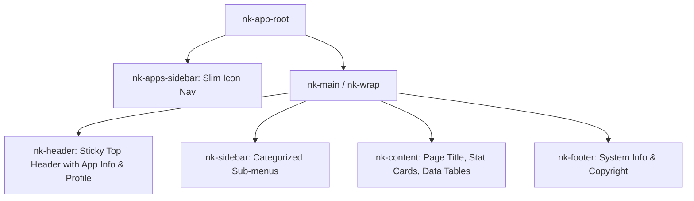

# Dokumentasi Design System DashLite Demo 3 & Implementasi Bionet Herbal MLM

Dokumentasi ini merangkum arsitektur visual, struktur komponen, tipografi modern, dan pemetaan token Tailwind CSS yang diekstraksi dari **DashLite Admin Template - Demo 3 (Sales & Enterprise Dashboard)** ([dashlite.net/demo3/index.html](https://dashlite.net/demo3/index.html)), serta adaptasi warnanya agar selaras dengan identitas bisnis **Bionet (Herbal Health & Bio-Energy Network Marketing)**.

---

## 1. Analisis Arsitektur & Hierarki Layout DashLite Demo 3

DashLite Demo 3 memiliki karakteristik unik yaitu **Double Sidebar / Apps-Based Layout** yang sangat ergonomis, modular, dan bersih:



### Komponen Layout Inti
1. **Apps Sidebar (`nk-apps-sidebar is-theme`)**:
   - Lebar ramping (~64px-72px) dengan latar belakang solid gelap elegan (*Theme Dark*).
   - Menampung logo brand mini di bagian atas, ikon menu cepat (Dashboard, Jaringan, PIN Stokis, RO Produk, Mutasi, Rekening), dan avatar profil pengguna di bagian bawah.
2. **Top Header (`nk-header nk-header-fixed is-light`)**:
   - Bersih, tinggi 68px, latar belakang putih bersih (`#ffffff`) dengan garis tepi halus (`#e5e9f2`).
   - Berisi logo/identitas aplikasi mini, indikator live network, tombol aksi cepat (salin link referral sponsor, sinkronisasi realtime), notifikasi, dan kartu profil mitra.
3. **Secondary Sidebar (`nk-sidebar`)**:
   - Lebar standar (240px-260px) dengan kategori menu bertingkat (`overline-title`), collapsible, dan badge status.
4. **Canvas Konten (`nk-content-body`)**:
   - Header Halaman (`nk-block-head`): Judul (`page-title`), deskripsi (`nk-block-des text-soft`), dan tombol aksi / date-filter dropdown di sisi kanan (`nk-block-tools`).
   - Sistem Grid Kartu (`row g-gs` / `grid grid-cols-12 gap-6`).
5. **Footer (`nk-footer`)**:
   - Rapi, tipis, menampilkan hak cipta Bionet v6 dan tautan bantuan.

---

## 2. Tipografi Modern yang Dipilih

DashLite menggunakan font standar sans-serif yang bersih. Untuk memberikan kesan **lebih modern, berwibawa, dan tajam** pada dashboard fintech MLM Bionet, dipilih kombinasi tipografi Google Fonts berikut:

| Peran | Font Family | Karakteristik & Alasan Pemilihan |
|---|---|---|
| **UI Body & Data Text** | **Plus Jakarta Sans** | Font geometris kontemporer karya Studio Gumpita Rahayu yang sangat bersih, keterbacaan angka (*tabular numbers*) sempurna untuk nominal Rupiah dan mutasi keuangan. |
| **Headings & Display Numbers** | **Outfit** | Tipografi display modern dengan proporsi bulat yang ramah namun berkelas, sangat cocok untuk nominal bonus, judul kartu, dan ringkasan omset. |
| **Kode Hash / Serial PIN** | **JetBrains Mono / Courier** | Monospace bersih dengan *high readability* untuk nomor lisensi serial PIN dan UUID transaksi. |

### Skala Tipografi:
- **Display / Big Metric (`amount`)**: `font-heading font-extrabold text-2xl lg:text-3xl tracking-tight text-slate-850`
- **Page Title (`page-title`)**: `font-heading font-bold text-xl lg:text-2xl text-slate-800`
- **Card Title (`title`)**: `font-heading font-bold text-base text-slate-800`
- **Overline Heading (`overline-title`)**: `font-semibold text-xs tracking-wider uppercase text-slate-400`
- **Body / Subtext (`sub-text`)**: `font-sans text-xs text-slate-500 font-normal leading-relaxed`

---

## 3. Adaptasi Palet Warna Sesuai Bisnis Bionet (Herbal & Network Marketing)

DashLite default menggunakan tema umum Indigo/Ungu (`#6576ff`). Untuk **Bionet**, seluruh skema warna dialihkan ke **Bio-Emerald & Herbal Vitality** (Kesehatan Alami, Bio-Energi, dan Kesejahteraan):

| Token Warna Bionet | Hex Code | Representasi & Penggunaan |
|---|---|---|
| **Bio-Emerald Primary** | `#059669` (Dark: `#10b981`) | Warna identitas utama: tombol CTA, status aktif, poin seimbang, ikon herbal. |
| **Bio-Emerald Dim / Soft** | `#ecfdf5` / `#d1fae5` | Latar belakang badge status sukses, kartu sorotan bonus sponsor. |
| **Cyber-Cyan (Vitalitas)** | `#0284c7` (Dark: `#06b6d4`) | Kaki kiri binary (Left Leg), link interaktif, transfer PIN, integrasi API. |
| **Amber-Gold (Prestasi)** | `#f59e0b` / `#d97706` | Peringkat kemitraan (Silver/Gold/Platinum), reward royalti, saldo pending. |
| **Crimson Red (Peringatan)** | `#ef4444` / `#f43f5e` | Mutasi penarikan dana keluar (Debit), biaya admin bank, status ditolak. |
| **Deep Forest Theme (Sidebar)** | `#06201a` / `#0b1a20` | Warna sidebar gelap DashLite khas tema *is-theme*. |
| **Canvas Light Background** | `#f5f6fa` | Latar belakang khas DashLite Demo 3 yang sangat bersih dan tidak melelahkan mata. |
| **Surface Card Background** | `#ffffff` | Latar belakang kartu dashboard dengan garis batas `border-slate-200`. |

---

## 4. Desain Komponen Khas DashLite Demo 3

### A. Kartu Metrik Penjualan & Bonus (`card card-bordered`)
- Latar belakang putih bersih dengan border halus `border-slate-200`.
- Judul kartu di kiri atas, ikon atau tooltip di kanan atas.
- Nominal utama berukuran besar (`font-extrabold text-2xl text-slate-850`).
- Indikator persentase pertumbuhan (+12.5% warna hijau / -1.93% warna merah).

### B. Tabel Data Kemitraan (`nk-tb-list`)
- Baris tabel berjarak rapi dengan border bawah lembut (`border-b border-slate-100`).
- Kolom User dilengkapi inisial avatar berwarna pastel:
  - Lingkaran avatar berukuran 36px dengan inisial tebal (`bg-emerald-100 text-emerald-700`).
  - Baris utama tebal (`font-semibold text-slate-800`), baris kedua tipis (`text-xs text-slate-400`).
- Status berbentuk dot badge (`badge-dot`): titik bulat kecil berdenyut diikuti teks status.

### C. Stepper Form & Fast Chips (Pencairan Dana Flip.id)
- Pilihan nominal instan berupa tombol pill mini (`Rp 100rb`, `Rp 250rb`, `Rp 500rb`, `Rp 1jt`, `Tarik Semua`).
- Rincian biaya admin real-time di dalam kotak berlatar belakang `bg-slate-50 border border-slate-200`.

---

## 5. Konfigurasi Tailwind CSS untuk Tema DashLite Bionet

Berikut skema konfigurasi Tailwind CSS (`tailwind.config.js`) yang memetakan seluruh sistem desain di atas:

```javascript
/** @type {import('tailwindcss').Config} */
export default {
  content: [
    "./index.html",
    "./src/**/*.{js,ts,jsx,tsx}",
  ],
  darkMode: 'class',
  theme: {
    extend: {
      colors: {
        bionet: {
          50: '#ecfdf5',
          100: '#d1fae5',
          200: '#a7f3d0',
          300: '#6ee7b7',
          400: '#34d399',
          500: '#10b981',
          600: '#059669', // Primary Herbal Green
          700: '#047857',
          800: '#065f46',
          900: '#064e3b',
          950: '#022c22',
        },
        dashlite: {
          sidebar: '#081c15',   // Deep Forest Dark
          bg: '#f5f6fa',        // Signature Dashlite Background
          border: '#e5e9f2',    // Clean divider line
          text: '#364a63',      // Primary typography
          soft: '#8094ae',      // Subtitle / muted text
        }
      },
      fontFamily: {
        sans: ['"Plus Jakarta Sans"', 'system-ui', 'sans-serif'],
        heading: ['Outfit', 'sans-serif'],
        mono: ['"JetBrains Mono"', 'monospace'],
      },
      boxShadow: {
        'dashlite': '0 1px 3px rgba(0, 0, 0, 0.05), 0 1px 2px rgba(0, 0, 0, 0.03)',
        'dashlite-md': '0 4px 12px rgba(0, 0, 0, 0.05)',
      }
    },
  },
  plugins: [],
}
```
