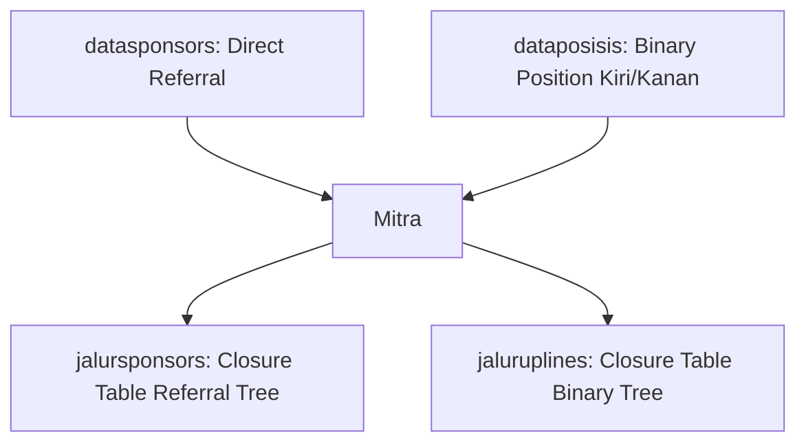

# Dokumentasi & Kamus Skema Database `bionetv5`

Dokumen ini berisi spesifikasi teknis dan rincian tabel dari database **`bionetv5`** pada lingkungan MySQL local.

---

## 📌 Ringkasan Statistik Tabel

| Kategori Modul | Jumlah Tabel | Tabel Utama & Berisi Data | Tabel Kosong / Legacy | Total Baris |
| :--- | :---: | :--- | :--- | :---: |
| **1. User & Profil** | 8 | `users`, `databankusers`, `alamatpengiriman`, `sessions` | `databankusers_copy`, `userbanks`, `profiles`, `students` | 15,292 |
| **2. Jaringan & Genealogi MLM** | 6 | `datasponsors`, `dataposisis`, `jalursponsors`, `jaluruplines` | `paketjoins`, `datauplinesxxx` | 248,384 |
| **3. Bonus, Poin & Reward** | 8 | `poinrewards`, `poinpasangans`, `poindistributors`, `reward`, `tempbonusro`, `cicilan` | `poinros`, `topbonusleaderships` | 11,621 |
| **4. Wallet & Keuangan** | 11 | `wallets`, `histories`, `transferharians`, `konfirmasitransaksi`, `flipbank`, `withdrawnnj`, `historytransferhariantidakmatch`, `walletros` | `walletusers`, `historytransferpins`, `transferbulanans` | 56,963 |
| **5. Stokis & Serial PIN** | 11 | `stokpins`, `stokbarangstokis`, `transaksipaketpin`, `saldostokiskeluar`, `saldostokismasuk`, `stokidspusats`, `paketpin`, `stokis` | `temptransferpins`, `stokpinusers`, `kategoripins` | 19,279 |
| **6. Produk & E-Commerce** | 10 | `transaksiitembarang`, `transaksi`, `pilihanpaket`, `repeatorder`, `barang` | `transaksis`, `transaksidetails`, `belanja`, `belanjaitem`, `kategoribarangs`, `kodebarangs` | 4,881 |
| **7. System & Log** | 11 | `logdatas`, `images`, `sertifikat`, `sequelizemeta`, `cekdatatable` | `antriancore`, `errormysql`, `tempmitrabarus`, `tempmitrabarusv2`, `temproemitra`, `tempupgardemitra` | 296,756 |
| **8. Master Wilayah** | 4 | `wilayahindonesia`, `indonesia_kode`, `provinsis` | `banks` | 98,282 |
| **TOTAL** | **70** | **44 Tabel Berisi Data** | **26 Tabel Kosong** | **751,591** |

---

## 🗂️ Rincian Modul Database

### 1. Modul User & Autentikasi

Menyimpan credential, hak akses, alamat, dan data bank untuk transfer bonus mitra.

#### `users` (5,532 baris)
- **Fungsi**: Master data keanggotaan mitra MLM.
- **Kolom Utama**:
  - `id` (INT, PK, Auto Increment)
  - `username` (VARCHAR, Unique): Identifier unik mitra.
  - `nama` (VARCHAR): Nama lengkap mitra.
  - `password` / `passwordHash` (VARCHAR): Hashed password login.
  - `role` (VARCHAR): Hak akses (`member`, `admin`, `stokis`).
  - `noHp` / `wa` (VARCHAR): Nomor kontak aktif.
  - `status` (VARCHAR): Status akun (`active`, `suspended`).
  - `createdAt` / `updatedAt` (DATETIME).

#### `databankusers` (5,566 baris)
- **Fungsi**: Rekening bank mitra untuk pencairan komisi/bonus.
- **Kolom Utama**: `idUsername` (FK to `users.username`), `bank` (Nama Bank), `namrek` (Nama Pemilik Rekening), `norek` (Nomor Rekening).

#### `alamatpengiriman` (50 baris)
- **Fungsi**: Alamat tujuan pengiriman produk yang dipesan mitra.

---

### 2. Modul Jaringan & Genealogi MLM (Tree Structure)

Sistem MLM Bionetv5 menggunakan kombinasi relasi langsung dan **Closure Table Strategy** (Path Enumeration) untuk query kilat hirarki pohon tanpa komputasi rekursif.

#### `datasponsors` (5,657 baris)
- **Fungsi**: Menyimpan sponsor langsung (direct sponsor/referral) dari setiap mitra.
- **Kolom Utama**: `idUsername` (ID Mitra Baru), `sponsor` (ID Upline Sponsor).

#### `dataposisis` (5,643 baris)
- **Fungsi**: Menyimpan penempatan pohon binary.
- **Kolom Utama**: `idUsername` (ID Mitra), `upline` (ID Induk Binary), `posisi` (`kiri` / `kanan`).

#### `jalursponsors` (86,435 baris) & `jaluruplines` (150,649 baris)
- **Fungsi**: **Closure Table Pattern** yang mencatat seluruh ancestor (leluhur) hingga keturunan terbawah.
- **Keunggulan**: Memungkinkan pencarian total omset grup, level kedalaman, dan generasi bonus dalam 1 query `SELECT` tanpa perkalian query `JOIN` berulang.
- **Kolom**: `idUsername`, `idUpline`, `idAnggota`, `posisi`, `levelUser`.

---

### 3. Modul Bonus, Poin & Reward

Mencatat akumulasi omset kaki kiri/kanan untuk pasangan dan reward.

#### `poinpasangans` (3,757 baris) & `poinrewards` (3,757 baris)
- **Fungsi**: Menampung saldo poin omset di kaki kiri dan kaki kanan mitra.
- **Kolom**: `idUsername`, `poinKiri`, `poinKanan`.

#### `reward` (234 baris)
- **Fungsi**: Riwayat klaim hadiah/reward (HP, Motor, Mobil, Umroh, Rumah, dll).
- **Kolom**: `idUsername`, `reward_ke`, `jenis`, `tanggal`, `deskripsi`, `status`.

---

### 4. Modul Wallet & Keuangan

Modul paling krusial untuk mencatat ledger transaksi keuangan, mutasi bonus, dan pembayaran.

#### `wallets` (36,335 baris)
- **Fungsi**: Ledger mutasi keuangan utama sistem (Bonus Sponsor, Pasangan, Matching, Potongan Admin, WD).
- **Kolom**: `idUsername`, `tanggal`, `deskripsi`, `jenis` (`debit`/`kredit`), `jumlah`, `saldo`.

#### `transferharians` (7,923 baris)
- **Fungsi**: Daftar pembayaran bonus harian yang ditransfer otomatis/manual ke bank mitra.

#### `flipbank` (155 baris)
- **Fungsi**: Master kode bank & status integrasi ke Payment Gateway Flip.id (Automatic Transfer/Payout).

---

### 5. Modul Stokis & Serial PIN

Pendaftaran & upgrade mitra bionet menggunakan kode serial PIN yang dibeli dari Stokis atau Pusat.

#### `stokpins` (11,401 baris)
- **Fungsi**: Master inventori kode serial PIN.
- **Kolom**: `namaPaket`, `idUsername` (pemilik PIN saat ini), `idPaket`, `kodeSerial`, `status` (`aktif`, `terpakai`).

#### `stokis` (11 baris) & `stokbarangstokis` (4,077 baris)
- **Fungsi**: Data 11 agen stokis resmi dan persediaan barang/produk fisik yang dipegang stokis.

#### `paketpin` (13 baris)
- **Fungsi**: Master jenis paket aktivasi (contoh: Silver, Gold, Platinum, Executive).

---

### 6. Modul E-Commerce & Belanja

#### `barang` (12 baris)
- **Fungsi**: Katalog 12 produk fisik unggulan bionet.
- **Kolom**: `nama`, `harga` (Harga Konsumen/Mitra), `hpp` (Harga Pokok Penjualan).

#### `transaksi` (1,480 baris) & `transaksiitembarang` (3,208 baris)
- **Fungsi**: Header & detail order transaksi pembelian barang/paket.

---

### 7. Modul System, Log & Master Wilayah

#### `logdatas` (296,557 baris)
- **Fungsi**: Tabel terbesar sistem untuk audit trail seluruh aktivitas member & sistem.

#### `wilayahindonesia` (91,553 baris) & `indonesia_kode` (6,695 baris)
- **Fungsi**: Master alamat Indonesia (Provinsi, Kabupaten, Kecamatan, Kelurahan, Kode Pos).

---
*Dokumen ini merupakan referensi resmi skema awal bionetv5.*
