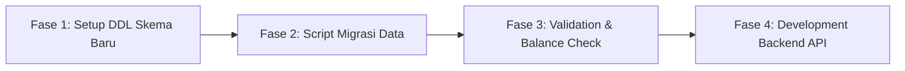

# Rencana Arsitektur & Strategi Rebuild Database (`rebuild_plan.md`)

Dokumen ini menjelaskan strategi teknis perancangan ulang (*rebuild*) database `bionetv5` menjadi arsitektur baru yang bersih, aman, cepat, dan mudah dipelihara.

---

## 🎯 Target Utama Rebuild

1. **Pembersihan Skema (Refactoring & Cleanup)**: Mengeliminasi 26 tabel tidak terpakai/duplikat, memangkas dari 70 tabel menjadi **~35 tabel efisien**.
2. **Normalisasi Relasi (Foreign Key Integrity)**: Menggantikan relasi berbasis string `idUsername` dengan Integer `user_id` (BIGINT/UUID) berindeks untuk peningkatan performa JOIN hingga 3-5x lipat.
3. **Pemisahan Log (Log Segregation)**: Memindahkan 296k baris `logdatas` dari RDBMS ke logging engine/partitioned table.
4. **Optimasi Perhitungan Bonus & Tree Traversal**: Menjaga efisiensi *Closure Table* (`jalursponsors` & `jaluruplines`) dengan menyelaraskan pengindeksan *Composite Index*.

---

## 🗑️ 1. Daftar 26 Tabel Yang Direkomendasikan Untuk Didepresiasi (Dihapus)

Berdasarkan hasil pemindaian data pada database `bionetv5`, berikut adalah tabel yang kosong (0 baris data) atau merupakan duplikasi dari versi terdahulu:

| No | Nama Tabel | Alasan Depresiasi / Tindakan Rebuild |
| :---: | :--- | :--- |
| 1 | `databankusers_copy` | Tabel backup manual (4,142 baris). Di-drop setelah migrasi `databankusers`. |
| 2 | `datauplinesxxx` | Tabel temp dump lama. Di-drop. |
| 3 | `transaksis` | Duplikat nama plural Sequelize dari `transaksi`. Di-drop. |
| 4 | `transaksidetails` | Redundan dengan `transaksiitembarang`. Di-drop. |
| 5 | `belanja` | Redundan dengan `transaksi`. Di-drop. |
| 6 | `belanjaitem` | Redundan dengan `transaksiitembarang`. Di-drop. |
| 7 | `walletusers` | Redundan dengan `wallets`. Di-drop. |
| 8 | `userbanks` | Redundan dengan `databankusers`. Di-drop. |
| 9 | `profiles` | Kolom tidak terintegrasi (`FatherName`). Di-drop / gabung ke `users`. |
| 10 | `students` | Tabel contoh / sisa penguji. Di-drop. |
| 11 | `paketjoins` | Redundan dengan `paketpin`. Di-drop. |
| 12 | `kategoripins` | Redundan dengan `paketpin`. Di-drop. |
| 13 | `stokpinusers` | Redundan dengan `stokpins`. Di-drop. |
| 14 | `historytransferpins` | Riwayat transfer PIN kosong. Gabung ke `logdatas` / `histories`. |
| 15 | `temptransferpins` | Tabel temporary kosong. Gunakan transaksi ACID DB. |
| 16 | `tempmitrabarus` | Tabel temp pendaftaran. Gunakan Redis/Session. |
| 17 | `tempmitrabarusv2` | Tabel temp pendaftaran v2. Gunakan Redis/Session. |
| 18 | `temproemitra` | Tabel temp Repeat Order. Gunakan Redis/Session. |
| 19 | `tempupgardemitra` | Tabel temp upgrade. Gunakan Redis/Session. |
| 20 | `antriancore` | Antrian async kosong. Gunakan Redis Queue (BullMQ/RabbitMQ). |
| 21 | `errormysql` | Log error database. Gunakan Sentry / Logger Service. |
| 22 | `poinros` | Poin RO kosong. Gabung ke `poinrewards`. |
| 23 | `topbonusleaderships` | Tabel kosong. |
| 24 | `transferbulanans` | Redundan dengan `transferharians`. |
| 25 | `kategoribarangs` | Tidak terpakai. Gabung ke master `barang`. |
| 26 | `kodebarangs` | Tidak terpakai. Gabung ke master `barang`. |

---

## 🛠️ 2. Strategi Perbaikan Skema Baru (Clean Schema Architecture)

### A. Penggunaan Primary Key & Foreign Key Standar (`BIGINT`)

- **Masalah Lama**: Sebagian besar tabel (`wallets`, `datasponsors`, `stokpins`) mereferensikan user menggunakan string `username` atau `idUsername` (VARCHAR).
- **Solusi Rebuild**:
  - `users.id` (BIGINT, Primary Key)
  - Seluruh tabel anak menggunakan `user_id` (BIGINT, Indexed Foreign Key)
  - `username` tetap diset UNIQUE di tabel `users` untuk keperluan login/referral link.

### B. Struktur Tabel Genealogi (Closure Table Optimization)

- Pertahankan tabel `jalursponsors` dan `jaluruplines`.
- Tambahkan **Composite Index** wajib:
  ```sql
  ALTER TABLE jalursponsors ADD INDEX idx_upline_level (idUpline, levelUser);
  ALTER TABLE jalursponsors ADD INDEX idx_anggota_upline (idAnggota, idUpline);
  
  ALTER TABLE jaluruplines ADD INDEX idx_upline_posisi (idUpline, posisi, levelUser);
  ```

### C. Manajemen Log & Transaction Safety

- **Transaction Ledger (`wallets`)**: Wajib menggunakan DB Engine **InnoDB** dengan level isolasi `REPEATABLE READ` atau `READ COMMITTED` untuk mencegah *race condition* saat bonus pasangan dihitung secara bersamaan.
- **Auditing (`logdatas`)**: Dipisahkan dari tabel operasional agar ukuran backup database utama tetap ringkas (< 50 MB).

---

## 🚀 3. Tahapan Pengerjaan Rebuild (Roadmap)



1. **Fase 1: Perancangan Skema Baru (DDL)**
   - Membuat file migrasi DDL SQL untuk 35 tabel bersih hasil refactoring.
2. **Fase 2: Script Ekstraksi & Migrasi Data Existing**
   - Membuat script Node.js/Python untuk memindahkan 5.5k user, 11.4k PIN, 36k wallet, 150k closure tree dari `bionetv5` ke database baru.
3. **Fase 3: Verifikasi Audit Keuangan & Poin**
   - Memastikan saldo wallet, total poin pasangan, dan struktur pohon antara DB lama dan DB baru **100% identik**.
4. **Fase 4: Integrasi Framework Backend Baru**
   - Menghubungkan database bersih ke API Framework (NestJS/Express/Laravel).

---
*Dokumen rencana ini menjadi acuan eksekusi teknis Rebuild Bionet.*
